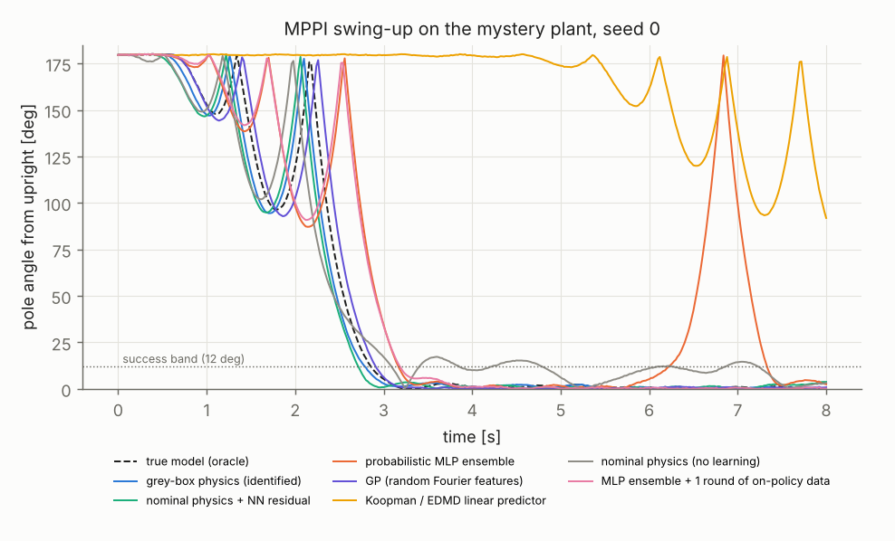
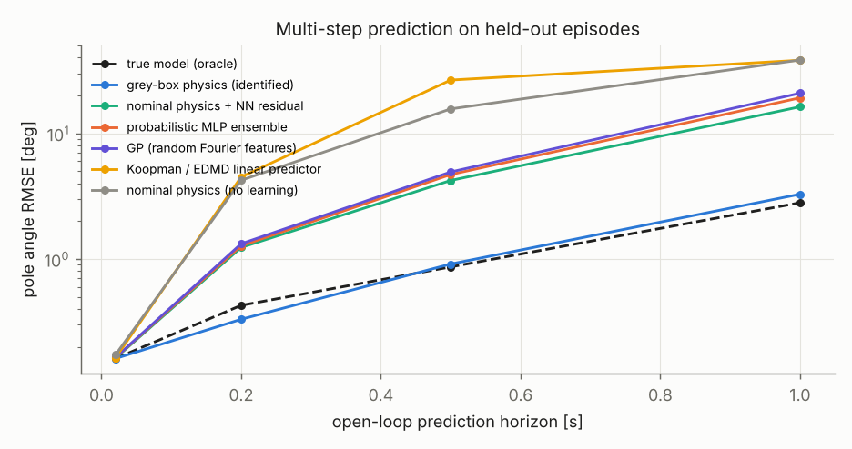

# Learned-Model MPPI: Which Dynamics Model Should a Sampling MPC Trust?

A model-predictive path integral (MPPI) controller swings up and balances a cart-pole whose real dynamics differ from the textbook model in ways a hardware team would recognize. The force actuator has a 100 ms lag whose state is not measured, a ±1 N deadzone and ±10 N saturation, the cart has Coulomb and viscous friction, and the pole is 20 % heavier and 10 % longer than the nominal parameters. Seven dynamics models are fit to the same 30k logged transitions and compared three ways, on open-loop prediction, on the calibration of their uncertainty, and on closed-loop swing-up with the same MPPI controller over 10 seeds.

The grey-box model, the textbook equations plus lag, deadzone and friction terms identified by gradient descent through a differentiable simulator, matched the true model in closed loop (10/10 swing-ups, 0.48° median final error) and recovered pole mass and length within 2 %. The textbook model swung up 7/10 times and settled 5° off vertical. The probabilistic MLP ensemble started at 5/10 and reached 10/10 after one round of on-policy data aggregation. The Koopman/EDMD linear predictor never swung up, for a structural reason shown below.

Everything is simulation, and the "true" plant is one I wrote, so the ranking says more about model structure than about any real robot.



## The plant

State $x = [p, \theta, \dot p, \dot\theta]$ with $\theta = 0$ hanging and $\theta = \pi$ upright, sampled at 50 Hz with zero-order-hold commands and integrated with RK4 at 1 kHz.

$$(m_c + m_p\sin^2\theta)\,\ddot p = f - b_c\dot p - F_c\tanh(\dot p/0.02) + m_p\sin\theta\,(l\dot\theta^2 + g\cos\theta) + \dots$$

$$\tau_a \dot f = \mathrm{dz}(\mathrm{sat}(u)) - f, \qquad \mathrm{dz}(u) = u - \mathrm{sign}(u)\,d \ \text{ for } |u| > d, \ 0 \text{ otherwise}$$

| Parameter | Nominal (given to the learner) | True plant |
|---|---|---|
| Pole mass $m_p$, length $l$ | 0.30 kg, 0.50 m | 0.36 kg, 0.55 m |
| Cart viscous / Coulomb friction | 0, 0 | 1.0 N s/m, 0.8 N |
| Pivot friction | 0 | 0.004 N m s/rad |
| Actuator lag $\tau_a$ (hidden state) | none | 100 ms |
| Deadzone, saturation | none, 10 N | 1 N, 10 N |
| Sensor noise (std) | | 1 mm, 2 mrad, 0.01 m/s, 0.02 rad/s |

The first version of this plant was too easy. The nominal model swung it up every time, which made the comparison meaningless, so the friction, the lag and the parameter error were raised until the textbook model started failing.

## The models

All seven sit behind one batched PyTorch interface (`init_aux`, `step`, `rollout`) so the same object serves evaluation and the controller.

| Model | What it is |
|---|---|
| `oracle` | The true equations and parameters, integrated with 2 RK4 substeps instead of the plant's 20, and a smooth deadzone |
| `nominal` | Textbook cart-pole with the nominal parameters, no lag, no friction |
| `greybox` | The oracle's structure with 7 unknown parameters (log-parameterized), fit by Adam on 10-step (0.2 s) simulation error through the differentiable simulator |
| `mlp_ensemble` | PETS-style ensemble of 5 MLPs (2×128, SiLU) predicting mean and log-variance of the state change, Gaussian NLL, bootstrapped data, soft-bounded variance |
| `hybrid_residual` | `nominal` physics plus an ensemble trained on its residual |
| `rff_gp` | GP regression with an RBF kernel approximated by 1500 random Fourier features (Bayesian linear regression), lengthscale and noise picked on validation |
| `koopman_edmd` | EDMD with control. 91 lifted features (trig products and 80 RBFs), $z^+ = Az + Bu$, decoded each step |

The learned models get translation-invariant inputs $[\sin\theta, \cos\theta, \dot p, \dot\theta, u_k, u_{k-1}, u_{k-2}]$. The physics models rebuild the hidden actuator force by running their filter over the last 10 commands.

The data are 100 training, 25 validation and 25 test episodes of 6 s. Each episode starts either near the bottom or near the top (40 %) and is driven by an Ornstein-Uhlenbeck force with random amplitude and bandwidth plus occasional step holds. A weak PD "track keeper" on cart position keeps episodes on the 6 m track. Without it, many episodes ran off the end within two seconds and the data barely covered the useful state space.

MPPI uses 512 samples, a 40-step (0.8 s) horizon, $\sigma = 4$ N, $\lambda = 1$, and the cost $8(1 + \cos\theta) + 0.5p^2 + 0.01\dot p^2 + 0.02\dot\theta^2 + 10^{-3}u^2$ with a soft wall at $|p| > 2$ m. With the ensemble, sample $k$ is rolled out through member $k \bmod 5$, so a plan is scored against every member rather than their mean. An episode is a success if the pole stays within 12° of upright and the cart within 2 m for the last 2 s of an 8 s run.

## How to run

```bash
pip install -r requirements.txt
python3 scripts/run_experiments.py --stage all --seeds 10    # data, fit, predict, control, round 2 (~45 min on 2 cores)
python3 scripts/plot.py                                      # figures + results/summary.md
python3 scripts/input_gain_check.py                          # the Koopman diagnosis below
python3 scripts/history_ablation.py                          # command-history ablation (~2 min)
python3 -m pytest tests                                      # 8 tests, ~10 s
docker build -t learned-mppi . && docker run --rm learned-mppi
```

## Results

### Open-loop prediction on held-out episodes



Pole-angle RMSE in degrees at the end of an open-loop rollout from logged states and commands.

| Model | 0.02 s | 0.2 s | 0.5 s | 1.0 s |
|---|---|---|---|---|
| oracle | 0.16 | 0.43 | 0.87 | 2.8 |
| greybox | 0.16 | 0.33 | 0.91 | 3.3 |
| hybrid_residual | 0.16 | 1.24 | 4.2 | 16.3 |
| mlp_ensemble | 0.16 | 1.27 | 4.7 | 19.2 |
| rff_gp | 0.17 | 1.32 | 4.9 | 20.9 |
| koopman_edmd | 0.16 | 4.5 | 26.6 | 38.2 |
| nominal | 0.17 | 4.2 | 15.7 | 38.4 |

One-step error is sensor noise for every model. The differences only appear over the horizon MPPI actually plans over. The grey-box model beats the oracle at 0.2 s because the oracle integrates with 2 substeps against the plant's 20 and the identified parameters absorb part of that discretization error.

### Grey-box identification

| Parameter | True | Identified | Error |
|---|---|---|---|
| Pole mass | 0.36 kg | 0.353 kg | −2.0 % |
| Pole length | 0.55 m | 0.551 m | +0.1 % |
| Cart Coulomb friction | 0.8 N | 0.789 N | −1.3 % |
| Cart viscous friction | 1.0 N s/m | 0.817 N s/m | −18 % |
| Actuator lag | 100 ms | 111 ms | +11 % |
| Deadzone | 1.0 N | 0.904 N | −9.6 % |
| Pivot friction | 0.004 | 0.006 N m s/rad | +49 % |

The parameters that dominate the motion came back within 2 %. Viscous and Coulomb friction trade off against each other on data where the cart velocity rarely changes sign slowly, and the lag and deadzone trade off because a smaller deadzone with a slower lag delays the force in a similar way. Pivot friction is barely excited.

### Calibration of one-step 95 % intervals on test data

| Model | $p$ | $\theta$ | $\dot p$ | $\dot\theta$ |
|---|---|---|---|---|
| mlp_ensemble | 0.959 | 0.962 | 0.934 | 0.945 |
| rff_gp | 0.954 | 0.954 | 0.943 | 0.946 |

Both are close to nominal coverage at one step. This says nothing about multi-step calibration, which is where an MPPI controller would use it.

### Closed-loop swing-up, 10 seeds each

| Model | Success | Median time to upright | Median final angle error | Mean MPPI step |
|---|---|---|---|---|
| oracle | 10/10 | 2.61 s | 0.51° | 40 ms |
| greybox | 10/10 | 2.59 s | 0.48° | 39 ms |
| rff_gp | 10/10 | 2.58 s | 0.59° | 42 ms* |
| hybrid_residual | 7/10 | 2.71 s | 0.54° | 87 ms |
| nominal | 7/10 | 3.33 s | 4.97° | 39 ms |
| mlp_ensemble | 5/10 | 3.15 s | 0.45° | 19 ms |
| mlp_ensemble, round 2 | 10/10 | 2.72 s | 0.49° | 19 ms |
| koopman_edmd | 0/10 | never | 95° | 14 ms |

\* Three of the GP episodes overlapped with a C++ build on the same 2-core machine, which pushed their mean step to 70 and 110 ms. The value shown is the median over episodes. Episodes run in simulated time (the plant waits for the controller), so step time does not affect success here. It does say what could run at 50 Hz on this CPU, which is only the ensemble and the Koopman model. The physics models spend their time in float64 RK4 in Python.

Two of the five ensemble failures and all three hybrid failures ended with the cart at or past the 2 m edge of the success region (peak $|p|$ of 2.00 to 2.16 m). The other three ensemble failures were the pole leaving the 12° band during the final 2 s. The training data came from random excitation around a track keeper, so the states a balancing controller visits were sparse in it. Round 2 added the ten closed-loop episodes the first ensemble produced (from different seeds than the evaluation), retrained, and all ten evaluation episodes succeeded.

### Why the Koopman model never swung up

`scripts/input_gain_check.py` applies a 5 N push for 0.2 s and reads the change in $\dot\theta$ each model predicts.

| | Oracle | Grey-box | MLP ensemble | Koopman/EDMD |
|---|---|---|---|---|
| Pole hanging | −0.51 rad/s | −0.50 | −0.51 | −0.42 |
| Pole upright | +0.62 rad/s | +0.60 | +0.70 | −0.42 |

The true input gain on $\ddot\theta$ is proportional to $-\cos\theta$, so it changes sign between hanging and upright. In EDMD with control the input enters the lifted dynamics through a constant $B$, so the predicted effect of a push cannot depend on the state. Least squares averaged the two regimes, and the result is wrong in sign near the top. A bilinear lifting ($z^+ = Az + \sum_i u_i B_i z$) is the standard fix, and I did not implement it.

### How much history the learned models need

`scripts/history_ablation.py` refits the ensemble with 2, 5 and 10 past commands as inputs.

| Past commands | 0.2 s | 0.5 s | 1.0 s |
|---|---|---|---|
| 2 (used above) | 1.27° | 4.7° | 19.2° |
| 5 | 0.81° | 3.2° | 13.6° |
| 10 | 0.61° | 2.5° | 10.5° |

With a 100 ms lag sampled at 20 ms, the hidden actuator force depends on more than the last two commands. Ten commands halved the 1 s error. The grey-box model is still three times better at 1 s, because it knows the lag is a first-order filter and the network has to learn that from data.

## What worked

Putting known structure into the model. Seven parameters and a differentiable simulator beat every black-box model at every horizon past one step, trained in 24 s, and are interpretable enough to check against the truth.

Data aggregation. A single round of on-policy data took the ensemble from 5/10 to 10/10, which matches the PETS and DAgger argument that the controller's own state distribution is what the model needs to cover.

Splitting MPPI samples across ensemble members. It costs nothing over using the mean, and it makes plans that only work under one member's predictions score badly.

## What did not work

The first plant was too forgiving. With 5 % parameter error and no hidden lag the nominal model succeeded every time and nothing could be learned from the comparison.

Open-loop excitation alone ran episodes off the track. The PD track keeper fixed coverage but made the data closed-loop, which correlates input and state and is one reason the learned models struggled with translation while balancing.

The hybrid physics-plus-residual model did not beat the plain ensemble by much. Its base model has no lag, so most of the residual is the actuator, and the residual network had the same two-command history as the others (validation MSE on the normalized residual stayed at 0.49).

Five RK4 substeps in the physics models made the closed-loop runs too slow for 10 seeds of every model on this machine. Two substeps cut the integration cost by 2.5x and still kept prediction error far below the learned models.

Koopman/EDMD with linear input, as diagnosed above. The fitted $A$ also has spectral radius 1.0000, so the lifted dynamics are marginally stable and long rollouts drift.

## Tools and techniques applied

MPPI (information-theoretic MPC), differentiable simulation and gradient-based grey-box system identification, probabilistic ensembles with Gaussian NLL and soft-bounded variance (PETS), bootstrapping, residual (hybrid) modelling, Gaussian-process regression with random Fourier features, Koopman operator / EDMD with control, data aggregation (DAgger-style), uncertainty calibration, closed-loop excitation design, multi-step validation and ablation. PyTorch, NumPy, pandas, Matplotlib, pytest, Docker, GitHub Actions and Git.

## Topics from the list used here

- Model predictive control (1D) and decision-making (4D): learning-based MPC and model-predictive path integral control (MPPI).
- Nonlinear control (1E): swing-up of an underactuated system.
- Stochastic estimation (1H): Gaussian processes for system modeling, Monte Carlo methods.
- Robot dynamics (2A, 2C): RK4, automatic differentiation, friction modeling, motor and actuator dynamics (a hidden first-order lag), underactuated systems, identification of physical parameters.
- Sensor modeling and estimation (3A, 3B): sensor noise, least squares, maximum likelihood (Gaussian NLL).
- Classical machine learning (5A): kernel methods (random Fourier features), ridge regularization, feature engineering, hyperparameter selection on validation data, calibration and uncertainty estimation, distribution shift.
- Deep learning (5B): multilayer perceptrons, backpropagation, AdamW, cosine learning-rate schedule, uncertainty-aware networks.
- Reinforcement learning (5C): model-based RL with iterative on-policy data collection (PETS-style).
- Learning-based control and system identification (5D): neural-network system identification, Gaussian-process dynamics models, differentiable physics, learning MPC, Koopman operator methods and (extended) dynamic mode decomposition, neural residual dynamics, uncertainty-aware learned dynamics, hybrid physics and learned models.
- Advanced optimization (11): differentiable simulation, PyTorch autograd, gradient descent with Adam, regularized least squares with Cholesky solves.
- System identification (14): grey-box and black-box identification, persistently exciting inputs (an Ornstein-Uhlenbeck force), prediction-error (multi-step simulation-error) fitting, nonlinear system identification, experimental design, identifiability (the friction and lag trade-offs), train/validation/test separation, uncertainty quantification, ablation studies, benchmarking against baselines, reproducibility.
- Software engineering (8): Python, PyTorch, NumPy, pandas, Matplotlib, pytest, Docker, CI, Git, seed management, statistical comparison of algorithms, automated report generation.
- RoboJackets software training slides: Ubuntu, Docker, Git.

## What I learned

Model error has to be measured over the planning horizon. Every model was within sensor noise of the truth at one step, and the closed-loop ranking only shows up at 0.5 to 1 s.

Structure is worth more than capacity when the structure is right. When it is wrong in one specific way, as with a state-independent input gain, no amount of data fixes it.

A hidden state has to be recoverable from the inputs. The ensemble's main handicap was a feature choice, not its size.

The data distribution matters as much as the model class. The ensemble's failures were in states the excitation never visited, and its own closed-loop data fixed them.

## Limitations

The cart-pole is 4-dimensional and the "true" plant is a model I wrote, so this measures model structure under known mismatch, not performance on hardware. Each controller ran 10 episodes, so a 7/10 versus 10/10 difference is suggestive rather than tight (Fisher's exact test gives p = 0.21 for 7/10 against 10/10, and p = 0.03 for the ensemble's 5/10 against its round-2 10/10). Timing was measured in Python on a shared 2-core machine. The GP and ensemble uncertainties were checked at one step only, and MPPI does not use them beyond member splitting.

## Resume entry

**Learned-Model MPPI for Swing-Up Control** | Python, PyTorch, NumPy, pytest, Docker

- Raised MPPI swing-up success on a cart-pole with a hidden 100 ms actuator lag, deadzone and friction from 7/10 with the textbook model to 10/10 by identifying a grey-box model through a differentiable PyTorch simulator, which recovered pole mass and length within 2 % and Coulomb friction within 1.3 % from 30k transitions.
- Compared seven dynamics models (grey-box, PETS-style MLP ensemble, physics plus NN residual, random-Fourier-feature GP, Koopman/EDMD) on 1 s open-loop prediction, interval calibration and closed-loop control, and lifted the ensemble from 5/10 to 10/10 with one round of on-policy data aggregation at 19 ms per 512-sample MPPI step.
- Traced the Koopman model's 0/10 result to its state-independent input matrix, which predicted the wrong sign of the pole's response to a push when upright, and halved the ensemble's 1 s prediction error by extending its command history from 2 to 10 steps.

## Repository layout

```
lmppi/      plant.py (true plant), data.py (excitation, windows), models.py (7 models), mppi.py
scripts/    run_experiments.py, plot.py, input_gain_check.py, history_ablation.py
tests/      pytest suite (plant/torch agreement, deadzone, RFF kernel, end-to-end, MPPI balance)
results/    CSVs, figures, summary.md (data.pkl and models.pkl are regenerated, not committed)
```
